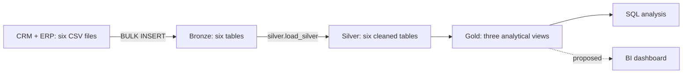

# SQL Server Sales Data Warehouse

A sales warehouse that integrates six CRM and ERP CSV files into a SQL Server analytical model. The project covers ingestion, data cleaning, cross-system integration, dimensional views, data quality reporting, and business analysis.

**Author:** Bryan Chen · **Stack:** SQL Server 2017+, T-SQL, SSMS/sqlcmd

## Architecture



| Layer | Objects | Responsibility |
|---|---|---|
| Bronze | Six tables | Load source-shaped records from CSV files |
| Silver | Six tables | Deduplicate customers; normalize codes and keys; handle dates and sales amounts |
| Gold | Two dimension views and one fact view | Integrate customers/products and expose sales for analysis |

Gold includes `gold.dim_customers`, `gold.dim_products`, and `gold.fact_sales`. Relationships are logical; the views do not enforce primary or foreign key constraints.

## Engineering and Analytical Work

- **ETL:** full-refresh stored procedures, ingestion timing, and propagated loading errors.
- **Data preparation:** customer deduplication, CRM/ERP key normalization, customer enrichment, current-product selection, and calendar-aware date conversion.
- **Modeling:** an explicit sales-record grain, customer/product dimensions, and documented business measures.
- **Quality:** detailed layer diagnostics, a consolidated PASS/REVIEW/FAIL scorecard, and executable assertions.
- **Analysis:** monthly sales comparisons, category revenue contribution, repeat purchasing, and coverage reporting.
- **Documentation:** source and Gold catalogs, field-level transformation rules, lineage, design alternatives, and operating instructions.

## Results

The supplied dataset contains 60,398 sales records. See [analysis findings](docs/analysis_findings.md) for measured revenue, category contribution, and repeat purchasing, with observation-period and data-quality qualifications. [Verification results](docs/validation.md) document the tested execution path and remaining limitations.

## Quick Start

### Prerequisites

- SQL Server 2017+ and SSMS or sqlcmd. Existing `TRIM` expressions require SQL Server 2017 or later.
- Permission to create a learning database, define objects, and bulk-load server-accessible files.
- The SQL Server service account must be able to read the CSV directory. A path on the SSMS workstation may not exist on a remote server.

The Bronze loader uses `C:\DataWarehouse\datasets` as an example directory. Either copy `datasets/` there or update the six paths in script 03 to the server-accessible dataset directory. Preserve the `source_crm` and `source_erp` subfolders. Do not commit credentials or local configuration secrets.

### First Run

**Script 01 drops and recreates `DataWarehouse` if it exists. Scripts 02 and 05 recreate their tables. Run setup only in a disposable learning environment.**

Open the scripts in SSMS and execute them in this order:

| Order | Script | Action |
|---|---|---|
| 1 | [01_create_database_and_schema.sql](scripts/01_create_database_and_schema.sql) | Reset the learning database and create schemas |
| 2 | [02_empty_tables_bronze.sql](scripts/02_empty_tables_bronze.sql) | Define Bronze tables |
| 3 | [05_empty_tables_silver.sql](scripts/05_empty_tables_silver.sql) | Define Silver tables |
| 4 | [03_bronze_procedure.sql](scripts/03_bronze_procedure.sql) | Define the configured Bronze loader |
| 5 | [07_bronze_trans_to_silver.sql](scripts/07_bronze_trans_to_silver.sql) | Define the Silver loader |
| 6 | [09_ETL_procedure_scripts.sql](scripts/09_ETL_procedure_scripts.sql) | Load Bronze, then Silver |
| 7 | [10_gold_layer.sql](scripts/10_gold_layer.sql) | Create or alter the three Gold views |
| 8 | [13_data_quality_summary.sql](scripts/13_data_quality_summary.sql) | Review quality results and investigate issues |
| 9 | [warehouse_checks.sql](tests/warehouse_checks.sql) | Run populated-warehouse assertions |
| 10 | [14_sales_analysis.sql](scripts/14_sales_analysis.sql) | Query sales trends, category contribution, and repeat purchasing |

Run [extension_checks.sql](tests/extension_checks.sql) for focused table-variable regression cases. Scripts 06, 08, 11, and 12 provide additional read-only inspection. Script 04 runs Bronze alone for optional source inspection and is unnecessary in the combined refresh above.

### Subsequent Refreshes

Run script 09, inspect script 13, run the warehouse assertions, then run script 14. Do not rerun database/table setup for a normal refresh. Redeploy procedure/view definitions only when their code changes. `GO` requires SSMS, sqlcmd, or another batch-aware client.

## Repository Layout

```text
SQL_Data_Warehouse_Project/
├── datasets/      # source_crm and source_erp CSV files
├── scripts/       # setup, loaders, diagnostics, scorecard, and analysis
├── tests/         # focused regression cases and warehouse assertions
├── docs/          # design, catalogs, operating instructions, and findings
├── .gitignore
├── LICENSE
└── README.md
```

## Documentation

- [Complete documentation index](docs/README.md)
- [SQL script index](scripts/README.md) and [dataset inventory](datasets/README.md)
- [Architecture, lineage, integration, and star schema](docs/architecture.md)
- [Source analysis and file scope](docs/source_system_analysis.md)
- [ETL rules](docs/etl_design.md) and [layer workflows](docs/data_layers.md)
- [Source/Silver catalog](docs/source_data_catalog.md) and [Gold catalog](docs/data_catalog.md)
- [Capabilities and metric definitions](docs/project_extensions.md)
- [Analytics patterns](docs/analytics_guide.md), [findings](docs/analysis_findings.md), and [verification](docs/validation.md)
- [Operating workflow](docs/development_workflow.md) and [test instructions](tests/README.md)

## Scope and Limitations

Full refreshes replace previous states and are not atomic across all tables. Gold keys use recalculated `ROW_NUMBER()` values and are not durable external identifiers. Historical sales use current product attributes. Monetary columns use integer source units; currency and historical profit are not established. Missing source dates are preserved as nulls and reported. Quality reports do not automatically gate publication.

The project does not deploy a dashboard, incremental processing, historical dimensions, or an orchestration platform. Design comparisons and optional SQL examples are documented separately from implemented capabilities.

## License

Project code is distributed under the [MIT License](LICENSE). Dataset fields and limitations are described in the source documentation; the project license does not establish ownership or additional rights in third-party source data.
