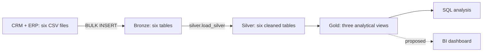
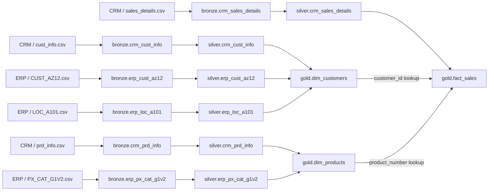
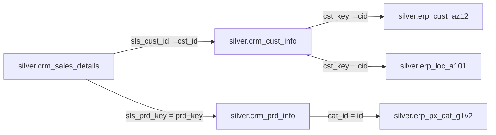
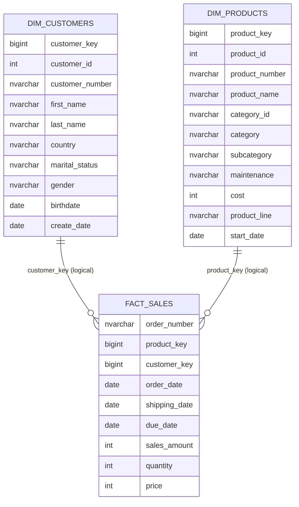
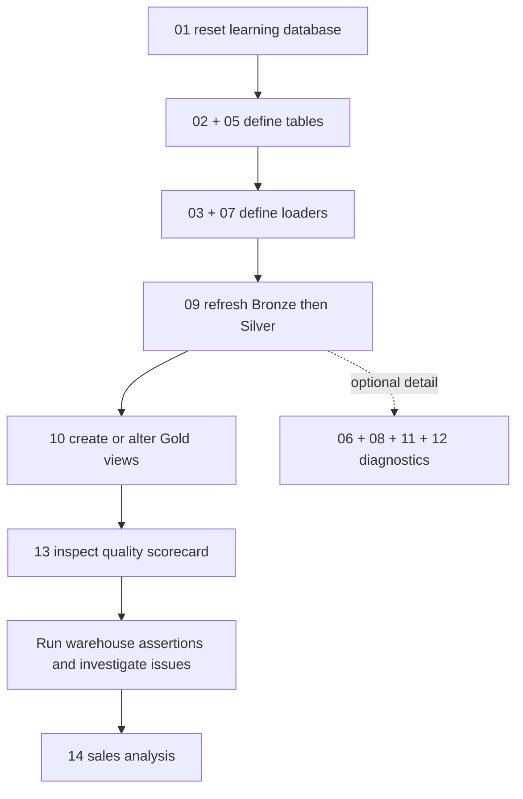

# Warehouse Architecture and Data Model

This SQL Server project integrates CRM and ERP sales data through Bronze, Silver, and Gold schemas. The design separates source ingestion, data preparation, and analytical access. The diagrams describe the implemented SQL; planned capabilities are identified separately. Mermaid diagrams render directly in this document on GitHub.

## Architecture

Six CSV files feed six Bronze tables. Stored procedures refresh Bronze and Silver in batches. Gold exposes two dimension views and one fact view. Business intelligence integration is a planned extension.

## Data Lineage

The customer dimension combines CRM customer profiles with ERP demographics and locations. The product dimension combines current CRM product records with ERP categories. The sales fact view resolves customer and product keys through the dimension views.

The diagram shows source-to-target lineage and the dimension lookups used by the fact view.

## Integration and Key Standardization

Gold joins operate on cleaned Silver records. The first five characters of the original product key form `cat_id`, with hyphens replaced by underscores. Characters from position seven onward form the product business key. ERP customer identifiers are standardized by removing the `NAS` prefix or hyphens, depending on the source.

CRM gender values take precedence unless classified as `n/a`; ERP supplies the fallback value.

## Logical Star Schema

The sales mart consists of three views. Relationships represent intended logical cardinality, rather than enforced primary or foreign key constraints. Dimension business-key uniqueness and unmatched fact records require validation.

The fact grain is one Silver sales source record. `order_number` identifies an order, not a unique line. Uniqueness of an order-product combination must be established before using it as a line identifier.

## Layer Responsibilities

Bronze uses typed landing tables and full refreshes. It preserves source-shaped records, but does not retain arbitrary raw bytes or previous file snapshots. Silver standardizes values, derives product validity dates, and adds load timestamps. Gold integrates the cleaned records for analysis.

Deriving product end dates in Silver does not provide historical dimension tracking in Gold: the product view selects only current records.

## Execution and Validation

Database setup, procedure definition, data refresh, and analytical view creation are separate operations. `09_ETL_procedure_scripts.sql` loads both layers. `04_load_tables_bronze.sql` is an optional Bronze-only operation and is not required for the normal combined refresh. Quality scripts return results for manual inspection, including the consolidated scorecard in script 13. Script 14 provides sales analysis.

`10_gold_layer.sql` uses rerunnable view definitions in separate batches. Bronze errors propagate to the caller, and invalid sales dates become null during Silver conversion. See [project extensions](project_extensions.md) for the scorecard, analytical queries, and focused regression checks.

## Modeling Decisions and Limitations

- `ROW_NUMBER()` produces `bigint` keys that are recalculated from the underlying data. These are not persisted identifiers and should not be stored externally as stable references.
- Customer deduplication retains the latest creation date per `cst_id`. Equal dates do not have a deterministic tie-breaker.
- Gold products are restricted to `prd_end_dt IS NULL`. Historical sales therefore use current product attributes. A missing current product can leave the fact product key null because the fact uses a left join.
- The product view exposes `maintenance`, as documented in the [data catalog](data_catalog.md).
- Monetary fields currently use `int`. Currency and rounding policy are not defined. Current product cost is insufficient to establish historical transaction profit.
- Diagram cardinalities describe the intended model; runtime validation results are not included.

## Implementation References

| Component | Source |
|---|---|
| Bronze ingestion | [03_bronze_procedure.sql](../scripts/03_bronze_procedure.sql) |
| Silver structure | [05_empty_tables_silver.sql](../scripts/05_empty_tables_silver.sql) |
| Silver transformations | [07_bronze_trans_to_silver.sql](../scripts/07_bronze_trans_to_silver.sql) |
| Refresh sequence | [09_ETL_procedure_scripts.sql](../scripts/09_ETL_procedure_scripts.sql) |
| Analytical model | [10_gold_layer.sql](../scripts/10_gold_layer.sql) |
| Gold validation | [12_gold_data_quality.sql](../scripts/12_gold_data_quality.sql) |

Mermaid diagrams are maintained directly in this document. Update the relevant diagram whenever the implemented architecture or relationships change.

See the [documentation index](README.md) for design concepts, source analysis, layer workflows, and analytical patterns.
