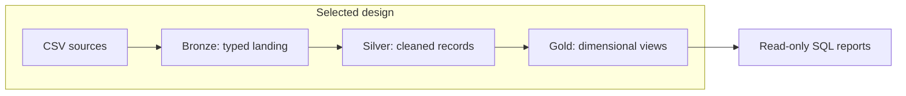

# Architecture Decisions

## Purpose

The warehouse provides a consistent sales analysis model from separate customer, product, sales, demographic, location, and category files. Without a shared preparation layer, every analysis would repeat key cleanup, duplicate handling, and cross-system joins. Centralizing these rules makes analytical queries simpler and their assumptions visible.

The project separates data preparation from consumption. Data engineering concerns include ingestion, cleaning, and integration. Exploratory analysis establishes coverage and distributions. Business analysis combines validated measures with dimensions to answer sales questions.

## Architecture Families

| Family | Primary concern | Relationship to this project |
|---|---|---|
| Data warehouse | Curated, structured data for consistent analytical queries | Selected: relational SQL Server warehouse |
| Data lake | File/object storage for raw and varied data, with later interpretation | Not deployed; a CSV folder alone does not establish a managed lake |
| Lakehouse | Lake storage combined with table-management and analytical capabilities | Not deployed; Bronze/Silver/Gold names do not imply lakehouse technology |
| Data mesh | Domain ownership and data-product operating practices | Not deployed; requires organizational practices beyond schema design |

## Modeling and Organization Approaches

These approaches address different design concerns and can be combined; they are not mutually exclusive product choices.

| Approach | Typical flow | Tradeoff | Project choice |
|---|---|---|---|
| Inmon | Sources → staging → integrated normalized enterprise warehouse → marts | Central integration with additional modeling and delivery work | No enterprise 3NF core |
| Kimball | Sources → preparation → dimensional marts using conformed dimensions | Accessible analytical models; consistency across marts requires shared definitions | Sales mart uses a dimensional star-style interface |
| Data Vault | Sources → staging → raw vault → business rules → marts | Detailed integration/history structures with more objects and processing | No hubs, links, or satellites |
| Medallion | Sources → Bronze → Silver → Gold | Explicit progression of data readiness; does not prescribe storage technology | Selected layer organization |

## Separation of Concerns

| Boundary | Owns | Does not own |
|---|---|---|
| Bronze | File ingestion and source-shaped typed records | Business cleaning or dimension integration |
| Silver | Source-level deduplication, standardization, date conversion, derived fields | Dashboard-specific grouping |
| Gold | Cross-system business entities and fact-to-dimension lookups | File ingestion or historical persistence |
| Analysis scripts | Metric aggregation, rankings, comparisons, coverage reporting | Rewriting source data |
| Documentation | Definitions, lineage, execution steps, assumptions | Replacing executable checks |

This boundary lets a country-cleaning rule change in Silver while reports continue using `country`. Conversely, a report can change its grouping without changing ingestion. Cross-layer dependencies remain explicit and flow toward analytical access.

## Key Tradeoffs

| Decision | Benefit | Limitation |
|---|---|---|
| Full refresh | Simple to inspect and reproduce from the six files | Replaces previous states; failed loads can leave partial refreshes |
| Typed Bronze columns | Straightforward SQL ingestion and validation | Some malformed inputs fail before Silver can clean them |
| View-based Gold | No separate Gold load; shared integration definitions | Query cost is paid at read time; keys are recalculated |
| Current product dimension | Simple product analysis | Historical sales inherit current product attributes |
| Manual quality scorecard | Clear issue counts with little infrastructure | Does not automatically prevent publication or query access |

No enterprise orchestration, incremental processing, or historical dimension subsystem is required to understand or run this version.
