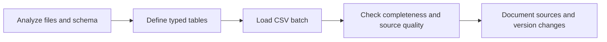
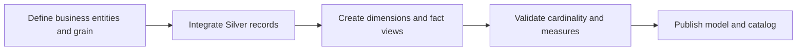

# Layer Design and Delivery

## Layer Comparison

| Aspect | Bronze | Silver | Gold |
|---|---|---|---|
| Definition | Source-shaped typed landing records | Cleaned and standardized source-level records | Integrated analytical entities |
| Objective | Separate ingestion from cleaning; inspect source issues | Prepare consistent records for joins and analysis | Provide an accessible sales model |
| Object type | Six tables | Six tables | Three views |
| Load method | Full refresh: `TRUNCATE` + `BULK INSERT` | Full refresh: `TRUNCATE` + `INSERT SELECT` | No stored load; evaluated when queried |
| Transformations | SQL type conversion during ingestion, no intentional business cleansing | Deduplication, trimming, code normalization, key derivation, date and amount rules | Customer/product integration, master-source precedence, current-product filtering, key lookup |
| Modeling | Source-aligned structures | Source-aligned structures with derived columns | Logical sales star schema |
| Aggregation | None | None | Base views retain row-level detail; scripts aggregate at query time |
| Metadata | Printed load timings/errors | `dwh_create_date` on each table | Calculated view columns; no load timestamp |
| Primary audience | Warehouse developer | Warehouse developer and analyst | Analyst and business-facing reporting |
| History limitation | Prior refresh overwritten | Prior refresh overwritten | Current customer/product representation; no persistent SCD2 |

## Bronze Workflow

1. **Analyze:** inspect headers, row counts, data types, candidate keys, date formats, and expected files. Source-system ownership and extraction assumptions are recorded in [source analysis](source_system_analysis.md).
2. **Build:** script 02 defines six tables; script 03 defines `bronze.load_bronze`; source paths must be readable by SQL Server.
3. **Validate:** inspect source issues with script 06 and source-date/input checks in script 13. Confirm loaded counts against the supplied file profile.
4. **Document:** maintain source catalog, loading configuration, and lineage. Commit changes after validation; do not commit credentials or temporary extracts.

The loader reports timing and rethrows errors. It does not archive raw files, reconcile every file count automatically, or roll back an entire multi-table refresh.

## Silver Workflow

1. **Analyze:** identify duplicate customers, dirty text, code variants, malformed dates, source-key differences, and inconsistent amounts.
2. **Build:** script 05 defines the target tables; script 07 defines `silver.load_silver`. Rules are listed in the [transformation matrix](etl_design.md#implemented-transformation-matrix).
3. **Validate:** script 08 supports detailed inspection; script 13 summarizes missing keys/dates, duplicate customer groups, date ordering, and amount relationships.
4. **Document:** preserve rule purpose and limitations. For example, nulling an invalid date is a handling policy, not restoration of the missing business date.

## Gold Workflow

1. **Analyze:** identify customer/product dimensions, sales measures, transaction grain, master-source rules, and reporting needs.
2. **Build:** script 10 creates or alters the three views in separate batches. It integrates customer enrichment and product categories, then resolves fact keys.
3. **Validate:** scripts 11/12 inspect joins and relationships; script 13 checks duplicate business keys, unmatched records, and fact/source row-count differences. These checks remain manual diagnostics.
4. **Document:** maintain the [star model](architecture.md#logical-star-schema), [catalog](data_catalog.md), [integration diagram](architecture.md#integration-and-key-standardization), and metric definitions.

Gold does not aggregate the base fact view. Monthly/customer/category aggregations belong to script 14 and the optional examples in the analytics guide. See [the operating workflow](development_workflow.md) for setup versus recurring refresh.
