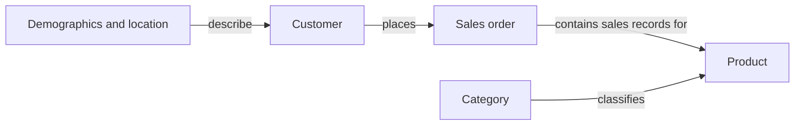
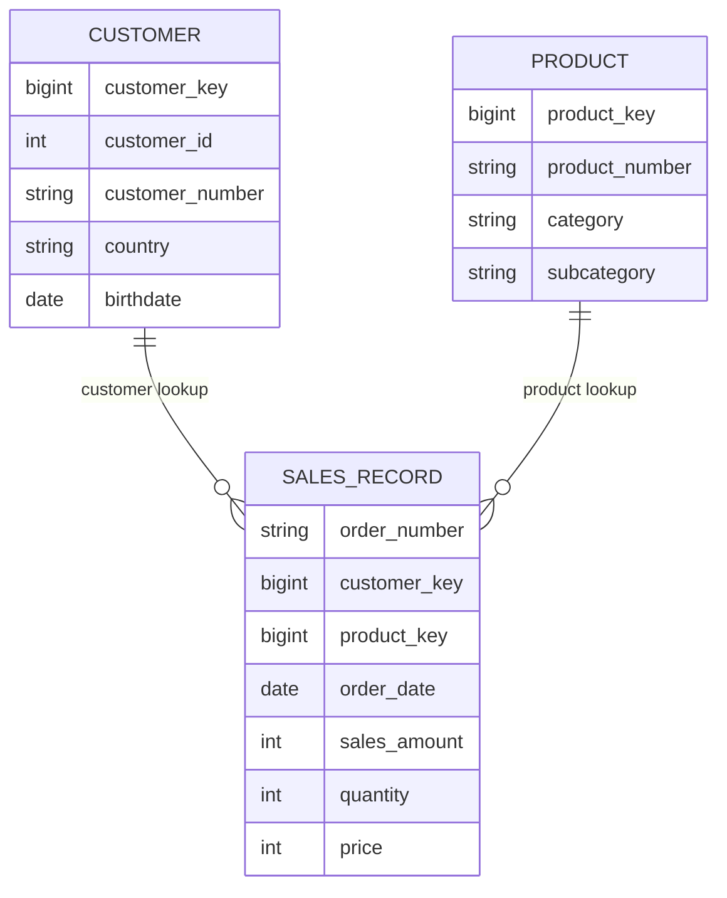
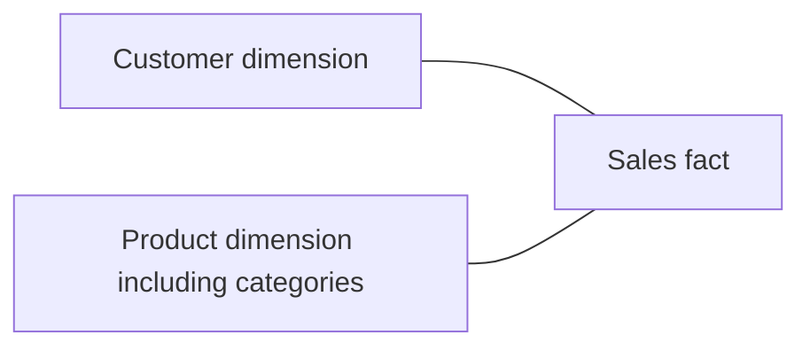
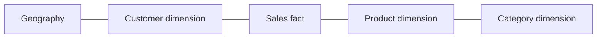

# Data Modeling

## Conceptual Model: Business Meaning

Customers place sales orders that contain products. Customer demographics and geography provide context; product categories group products. This level describes entities and business relationships without committing to SQL column types.

## Logical Model: Grain, Attributes, and Relationships

The analytical model contains customer and product dimensions around a sales fact. A fact row represents one Silver sales source record. Multiple rows can belong to one order. The source does not provide a separately established line identifier; neither order number alone nor an untested order-product combination should be declared a primary key.

The one-to-many relationships are intended logical relationships, contingent on unique dimension business keys. LEFT JOIN permits unresolved keys. These diagram symbols are not physical constraints.

## Physical Model: SQL Server Implementation

Bronze and Silver are physical tables defined in scripts 02/05. Gold objects are views defined in script 10. The [source/Silver catalog](source_data_catalog.md) lists every physical field; the [Gold catalog](data_catalog.md) lists view output types and definitions.

| Logical role | SQL implementation | Key behavior |
|---|---|---|
| Customer dimension | `gold.dim_customers` view | `customer_key BIGINT`, generated by ROW_NUMBER ordered by cst_id |
| Product dimension | `gold.dim_products` view | `product_key BIGINT`, generated by ROW_NUMBER ordered by start date and product key |
| Sales fact | `gold.fact_sales` view | Looks up dimension keys; no declared line primary key |

There are no enforced Gold PK/FK constraints. Money/quantity fields use INT, string attributes generally use NVARCHAR(50), and business dates use DATE. Currency and fractional-money policy are unspecified.

## Dimensions and Facts

| Role | Question | Project examples | Aggregation consideration |
|---|---|---|---|
| Dimension attribute | Who, what, where, when? | Customer name, country, category, order date | Group or filter; do not sum identifiers |
| Additive measure | How much or how many? | Sales amount, quantity | Sum across compatible fact rows |
| Non-additive measure | What rate or unit value? | Unit price, repeat percentage, average order value | Recompute numerator/denominator at the requested grain |
| Degenerate dimension | Which transaction? | Order number in fact view | Distinct orders differ from line count |

A numeric type does not automatically make a field a measure. Customer ID is numeric but should not be summed. Birthdate is descriptive; age requires an explicitly chosen as-of date.

## Star and Snowflake Schemas

The implemented star-style interface stores category and subcategory attributes inside the product dimension and geography inside the customer dimension. This simplifies reporting joins.

A snowflake alternative would split category or geography into further dimensions. It can reduce repeated descriptive attributes but adds joins and maintenance. It is not inherently required for large datasets, and a star schema is not restricted to small datasets.

The second diagram is a design comparison, not deployed schema.

## Business Keys and Surrogate Keys

Customer IDs/numbers and product numbers come from source domains and serve as business lookup keys. Warehouse surrogate keys separate analytical relationships from source identifier formats.

Two common generation strategies are persistent IDENTITY/SEQUENCE values stored in dimension tables, or calculated ROW_NUMBER values in a query. This project uses the latter. ROW_NUMBER returns BIGINT and its values can shift when underlying records or ordering change. It is adequate for this view-based model when all objects are queried consistently, but external systems should not retain those values as permanent identifiers.

## Data Integration and Catalog

The customer view combines profiles, demographics, and locations using cleaned keys. The product view combines current product records with category attributes. The fact resolves warehouse keys from sales business keys. See the [integration diagram](architecture.md#integration-and-key-standardization) and [transformation matrix](etl_design.md#implemented-transformation-matrix).

A data catalog explains each field's meaning, source, type, and limitations so a consumer can choose the right aggregation and understand a join. SQL users, reporting developers, and downstream analytical consumers should use the same definitions. A dashboard or machine learning consumer is a possible use, not a claim that such an artifact is deployed here.
