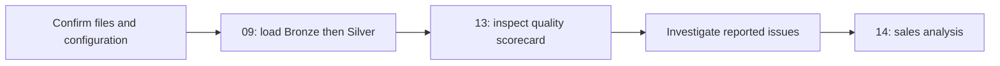

# Development and Operating Workflow

## Requirements and Configuration

Use SQL Server 2017+ and SSMS or sqlcmd. Existing TRIM expressions require SQL Server 2017 or later. GO is a client batch separator rather than a T-SQL statement sent directly through a database API.

The loader uses `C:\DataWarehouse\datasets` as a documented example root. Update its six paths to a directory visible to the SQL Server service, preserving the CRM/ERP subfolders and filenames. A path visible in a local editor may not exist on a remote database server. The service account needs read access; database loading permissions depend on server configuration. Do not store credentials in repository files.

## Initial Setup

Script 01 resets the `DataWarehouse` database if it exists. Scripts 02 and 05 drop/recreate their tables. Use a disposable learning database, and review these operations before execution.

| Step | Script | Result |
|---|---|---|
| 1 | 01 | Create database and schemas |
| 2 | 02 and 05 | Define Bronze and Silver tables |
| 3 | 03 and 07 | Define loading procedures after configuring source paths |
| 4 | 09 | Refresh Bronze, then Silver |
| 5 | 10 | Create or alter Gold views |
| 6 | 06, 08, 11, 12 as needed | Inspect detailed source, transformation, and relationship checks |
| 7 | 13 | Read consolidated quality results and investigate FAIL/REVIEW |
| 8 | tests/warehouse_checks.sql | Assert populated-warehouse integrity |
| 9 | 14 | Run sales analysis |
| 10 | tests/extension_checks.sql | Run focused, nonpersistent regression checks |

Script 04 runs Bronze alone for an optional inspection load. It is unnecessary if script 09 is already being used for the same refresh.

## Recurring Refresh

This diagram describes an operator workflow, not an automatic orchestration system. A Bronze error is rethrown and stops normal dependent execution. It does not roll back previously completed loads. Quality statuses do not automatically block report access. Reapply script 10 only when view definitions change or need deployment.

## Bulk Loading and Ordinary Inserts

| Method | Appropriate use | Project usage / consideration |
|---|---|---|
| BULK INSERT | Read a server-accessible data file into a table | Bronze uses FIRSTROW=2, comma delimiter, and TABLOCK |
| INSERT SELECT | Write a query's transformed result set | Silver loads cleaned Bronze records |
| INSERT VALUES | Add a small explicit set of rows | Table-variable fixtures in focused regression checks |

Bulk ingestion avoids constructing a separate SQL insert for each source row. This is not a blanket guarantee that it outperforms every batched INSERT strategy; file format, table indexes, logging, locking, and volume matter. No ingestion benchmark is claimed.

The current delimiter-based loader assumes compatible CSV formatting. Embedded commas, quoting, encoding, and line endings must be checked for replacement files. Typed Bronze fields can reject malformed source values before Silver processing.

## Git and Review

Git records local changes and commits; a hosted remote provides sharing and review. A practical workflow is:

1. Inspect the current diff and keep unrelated changes separate.
2. Change a focused SQL rule or report, then update its definitions and documentation.
3. Run focused checks and applicable read-only quality queries.
4. Review query results, data exclusions, and any destructive commands.
5. Commit the validated source and documentation together.
6. Push reviewed commits to the intended remote; pull or fetch shared updates before integrating concurrent changes.

Do not version passwords, machine-specific credentials, generated scratch files, or unreviewed result exports containing personal data. Preserve meaningful commit history and describe the concrete behavior changed. Commit and push operations are not performed by SQL scripts.

## Maintaining Documentation

Use [the documentation index](README.md) as the entry point. Update transformation rules with SQL changes, maintain column names/types in the catalogs, and update both Mermaid and SVG diagrams when relationships change. Optional analytics examples must remain distinct from executed deliverables and verified findings.
